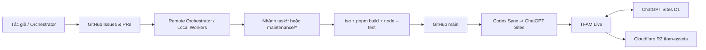

# Kiến trúc TFAM Platform (v250+)

## Hiện trạng hệ thống đã xác minh
- **Production Hosting:** OpenAI ChatGPT Sites (`appgprj_6abf3718495481919a2cd6954776f57e`) — URL live: `https://throughfrostandmyth.baonguyenduong254.chatgpt.site` (hiện đang live ở `siteVersion: 250`; xem trạng thái chi tiết và lịch sử rollback trong `ops/status.json` và `ops/releases/`).
- **Mã nguồn ứng dụng:** `site/` — Next.js `16.3.4` / React `19.2.6` / Vinext `1.0.0-beta.5` / Vite `8.0.13` / Cloudflare Workers (`wrangler`), quản lý phụ thuộc bằng `pnpm@11.25.0`.
- **GitHub (Public Repo):** `baonguyenduong254-cmd/tfam-platform` — nguồn chuẩn cho mã nguồn, migrations, tests, skills (`.agents/skills/`), và nhật ký vận hành (`ops/status.json`, `ops/handoff.json`, `ops/connections.json`). Không bật auto-deploy trực tiếp từ GitHub sang production.
- **Database live (ChatGPT Sites Managed D1 — binding `DB`):**
  - Revision hiện tại: `contentRevision: 32`, `atlasRevision: 25`, `presentationRevision: 34`.
  - Các bảng vận hành: `content`, `reader_accounts`, `reader_progress`, `chapter_comments`, `chapter_reactions`, `chapter_visits`, `admin_sessions`, `admin_login_limits`, `reader_rate_limits`, và cụm bảng TFAM Studio (`studio_volumes`, `studio_chapters`, `studio_chapter_revisions`, `studio_canon_entries`, `studio_canon_links`, `studio_knowledge_states`, `studio_what_if_scenarios`, `studio_published_snapshots`, `studio_import_staging`, `studio_audit_logs`).
  - *Lưu ý tách biệt môi trường:* Worker `through-frost-and-myth.tfamatlas.workers.dev` và D1 `tfam-content` trên tài khoản Cloudflare cá nhân là hạ tầng **legacy/riêng biệt**, không phải D1 live của ChatGPT Sites.
- **Media CDN (Cloudflare R2 — bucket `tfam-assets`):**
  - Public base URL: `https://pub-a2e7030237c14362985465386fcae671.r2.dev`.
  - Quy mô hiện tại: `2.464` object trên R2, `2.379` đường dẫn ánh xạ qua manifest build-time `site/lib/media/external-paths.json` (`assetUrl()`). Không đưa bộ media nặng nguyên gốc vào Git.

## Phân tầng sở hữu dữ liệu (4 lớp)
| Lớp | Hệ thống chuẩn | Dữ liệu sở hữu | Nguyên tắc bảo vệ |
| --- | --- | --- | --- |
| **Mã nguồn & Hợp đồng** | GitHub (`baonguyenduong254-cmd/tfam-platform`) | `site/`, `site/drizzle/`, `site/public/`, `site/lib/media/external-paths.json`, tests, `.agents/skills/`, `ops/`, `maintenance/` | Không lưu secret, token, DB dump, PII người đọc hay kho media thô |
| **Nội dung live & Người đọc** | ChatGPT Sites Managed D1 (`DB`) | `content` (`atlas`, `story:*`), `studio_*`, tài khoản/tiến độ/bình luận/reaction người đọc | Không ghi đè bằng seed JSON khi deploy code; không chạy migration phá hủy |
| **Lưu trữ Media** | Cloudflare R2 (`tfam-assets`) | Audio soundtrack, ảnh quân đội, kỳ quan, nhân vật, Maison Vestigium, video | Đồng bộ manifest `external-paths.json` khi thêm/gỡ asset; kiểm kê trước khi xóa |
| **Trạng thái tạm trên trình duyệt** | `localStorage` / `sessionStorage` | Tiến độ đọc khách (`tfam-reading-history-v1`), tùy chọn giao diện/âm thanh, giỏ lưu niệm `Imperial Vault` | Chỉ là cache cục bộ; không coi là nguồn đồng bộ đa thiết bị |

## Kiến trúc điều phối & phát hành (Cloud-First)

## Quy tắc vận hành bắt buộc
1. Mọi phiên làm việc bắt đầu bằng việc đọc `AGENTS.md`, `README.md`, `ops/status.json`, `ops/handoff.json`, và các PR/Issue đang mở.
2. Code thay đổi phải qua nhánh `task/*` hoặc `maintenance/*`, vượt qua `npx tsc --noEmit`, `node --test tests/*.test.mjs`, và `pnpm run build` trước khi merge vào `main`.
3. Phát hành production thực hiện có kiểm soát từ commit đã xác minh trên `main` sang ChatGPT Sites, ghi đầy đủ provenance (`siteVersion`, `deploymentId`, `versionId`, `sourceCommit`, `rollback`) vào `ops/releases/` và `ops/status.json`.
4. Giữ ChatGPT Sites làm hosting production duy nhất ở giai đoạn hiện tại; không mở thêm hệ thống hosting song song gây lệch dữ liệu (split-brain).

