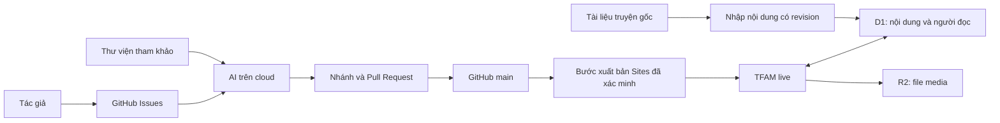

# Kiến trúc TFAM

## Hiện trạng đã xác minh
- Site đang chạy trên ChatGPT Sites; live version210; baseline nhập nguồn là209.
- GitHub riêng tư: baonguyenduong254-cmd/tfam-platform; kết nối có quyền đọc/ghi.
- D1 binding DB có các bảng: content, reader_accounts, reader_progress, chapter_comments, chapter_reactions, chapter_visits, admin_sessions, admin_login_limits, reader_rate_limits.
- Source v209 đã xác minh R2 public base URL là https://pub-a2e7030237c14362985465386fcae671.r2.dev. Hiện còn2.269 mapping ảnh: military1.100, monuments268, vestigium901. Đã xóa72 oil portraits trên R2 theo xác nhận chủ dự án; anime Castilian ở source/public. File mẫu trên R2 tải được. Một số ảnh vẫn dùng URL domain site; không phải toàn bộ media đều đã chuyển sang R2.
- Bucket quản trị đã xác minh: tfam-assets. Đã kiểm kê hết2351 object trước retirement;72 portrait đã xóa, còn2279 object. Truy cập quản trị qua dashboard đã đăng nhập; không tạo R2 API key. Không sao lưu72 ảnh theo yêu cầu chủ dự án. Cấu hình hosting v209 có r2=null: việc đọc media hiện qua URL công khai, không chứng minh một R2 binding quản trị trực tiếp.
- Nội dung bảng content quá lớn cho công cụ xem hàng hiện tại; chưa có kiểm kê đầy đủ nội dung live.

## Nguồn chuẩn theo loại dữ liệu
| Loại | Nơi giữ chuẩn | Bản sao / tham chiếu |
| --- | --- | --- |
| Code, cấu hình, schema, tests | GitHub sau khi nhập source và đối chiếu xong | Bản source cần xuất bản của Sites |
| Nội dung live có trình sửa trên site | D1 hiện có | Export có revision để so sánh và khôi phục |
| Bản thảo truyện gốc, quyết định canon | Tài liệu gốc của tác giả | Chỉ đưa vào site qua lần nhập có nguồn và revision |
| Cờ, chân dung, ảnh, audio, video | R2 hiện có hoặc nguồn asset đã xác minh | Git giữ asset manifest, không giữ thêm bản media thừa |
| Tài khoản, tiến độ, bình luận, reactions | D1 hiện có | Cache trình duyệt cho trải nghiệm |
| Quy tắc unlock, thứ tự trang, quyết định giao diện | File được duyệt trong GitHub | Runtime config được phát hành cùng code |
| Thư viện cho AI tham khảo | references/catalog.json | Tài liệu upstream được đọc có mục tiêu |
| Trạng thái công việc và release | Issues + ops + Git history | Chat chỉ dùng giao tiếp |

## Bản nhập đã hoàn tất
Source v209 được giữ nguyên trong site/. Tree SHA: 81de793c8a2d3e23d49bf2ad63b537600e06ee6e. Lần nhập không thay đổi production; đợt210 đã phát hành source cập nhật và được ghi tại ops/releases/210-source.json.

## Đích vận hành

Đường GitHub → source Sites → native Sites publication đã được thực hiện trên cloud cho210. Đây là phát hành theo commit đã kiểm tra, không tự deploy mọi merge.
Giữ Sites làm hosting hiện tại. Không mở thêm một hệ thống hosting song song trong giai đoạn này.
