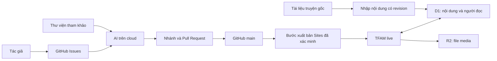

# Kiến trúc TFAM

## Hiện trạng đã xác minh
- Site đang chạy trên ChatGPT Sites; baseline v209.
- GitHub riêng tư: baonguyenduong254-cmd/tfam-platform; kết nối có quyền đọc/ghi.
- D1 binding DB có các bảng: content, reader_accounts, reader_progress, chapter_comments, chapter_reactions, chapter_visits, admin_sessions, admin_login_limits, reader_rate_limits.
- R2 đang được chủ dự án sử dụng. Một số ảnh quan sát trên v209 vẫn có URL cùng domain với site; chưa kết luận toàn bộ media đã nằm trên R2.
- Tên bucket, public media base URL, phạm vi quyền ghi R2 và bản sao lưu chưa được xác minh.
- Nội dung bảng content quá lớn cho công cụ xem hàng hiện tại; chưa có kiểm kê đầy đủ nội dung live.

## Nguồn chuẩn theo loại dữ liệu
| Loại | Nơi giữ chuẩn | Bản sao / tham chiếu |
| --- | --- | --- |
| Code, cấu hình, schema, tests | GitHub sau khi nhập source và đối chiếu xong | Bản source cần xuất bản của Sites |
| Nội dung live có trình sửa trên site | D1 hiện có | Export có revision để so sánh và khôi phục |
| Bản thảo truyện gốc, quyết định canon | Tài liệu gốc của tác giả | Chỉ đưa vào site qua lần nhập có nguồn và revision |
| Cờ, chân dung, ảnh, audio, video | R2 hiện có hoặc nguồn asset đã xác minh | Git giữ asset manifest, không giữ thêm bản media thừa |
| Tài khoản, tiến độ, bình luận, reactions | D1 hiện có | Cache trình duyệt cho trải nghiệm |
| Quy tắc unlock, thứ tự trang, quyết định giao diện | File được duyệt trong GitHub | Runtime config được phát hành cùng code |
| Thư viện cho AI tham khảo | references/catalog.json | Tài liệu upstream được đọc có mục tiêu |
| Trạng thái công việc và release | Issues + ops + Git history | Chat chỉ dùng giao tiếp |

## Đích vận hành

Đây là kiến trúc mục tiêu. Mũi tên GitHub → Sites chưa tự động hoạt động chỉ vì đã tạo repo.
Giữ Sites làm hosting hiện tại. Không mở thêm một hệ thống hosting song song trong giai đoạn này.
